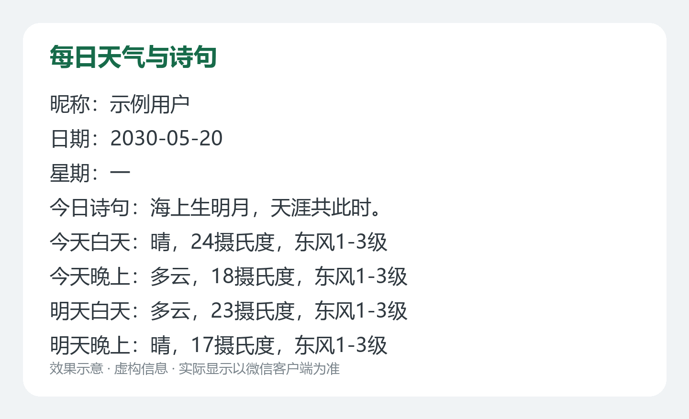
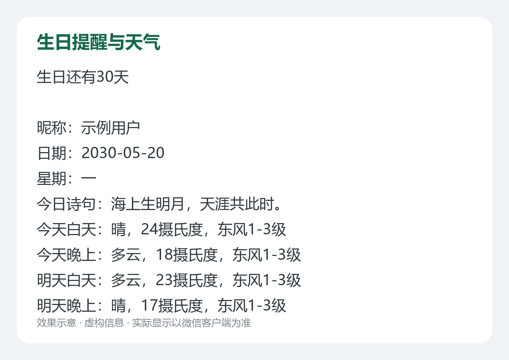
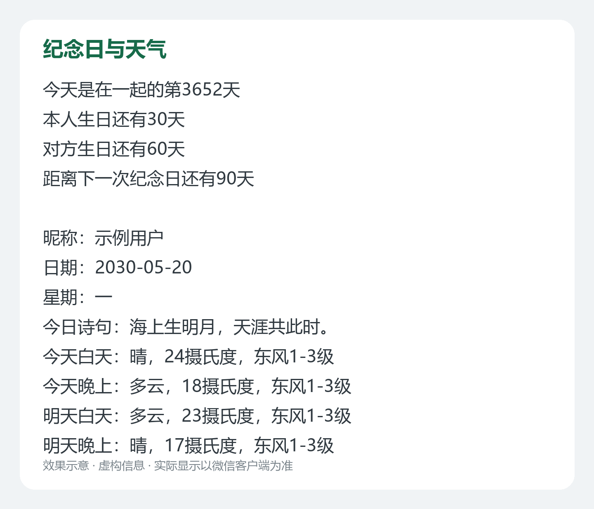

# 微信天气与诗句推送 · 通用部署版

**中文** | [English](README.en.md)

一份可以放到自己 GitHub 仓库运行的 Java 小工具：每天推送所在地区的天气、随机古诗，以及可选的生日和纪念日提醒。

**本包已清空原账号、收件人和个人日期。默认关闭定时，手动运行默认只检查、不发送。**

[直接开始部署](#第一步准备自己的账号) · [填写收件人](#第五步填写一位收件人) · [常见问题](#常见问题)

## 先看效果

以下图片均为虚构信息的效果示意，不是真实手机截图，也不代表微信一定保留字体颜色、开头或结尾。

### 单人天气与诗句



对应 [基础模板](templates/basic.txt)，不需要填写生日。

### 生日提醒



对应 [生日模板](templates/birthday.txt)，需要填写一项生日。

### 双人纪念日



对应 [双人模板](templates/couple.txt)，需要依次填写本人生日、对方生日、累计纪念日、周年倒计时。图中数值仅用于展示排版。

英文版素材：[基础模板](templates/basic.en.txt) · [生日模板](templates/birthday.en.txt) · [双人模板](templates/couple.en.txt)。英文标签不会自动翻译接口返回的中文天气、星期和古诗；英文示例图中的动态内容为译文示意。

## 需要修改什么

只有两处必须适配：

- **自己的 GitHub 仓库 Secrets**：保存 `WECHAT_APP_ID`、`WECHAT_APP_SECRET`、`AMAP_KEY`。
- **[WechatConfig.java](src/main/java/com/pt/vx/config/WechatConfig.java)**：填写每位收件人的 OpenID、模板 ID、昵称、详细地区、城市，以及可选日期。

不用修改发送服务、天气解析或诗句接口，也不要复用别人的密钥、OpenID、模板 ID。

## 第一步：准备自己的账号

1. 在 [微信公众平台测试号](https://mp.weixin.qq.com/debug/cgi-bin/sandbox?t=sandbox/login) 登录，取得自己的 AppID 和 AppSecret。
2. 每位收件人使用自己的微信扫描**这个测试号的二维码**并关注。后台出现的标识是 OpenID，不是微信昵称或微信号。
3. 在自己的 [高德开放平台](https://console.amap.com/dev/key/app) 创建应用和 Key，绑定服务选择 **Web服务**。确认账号有地理编码和天气查询权限及可用额度；微信小程序类型的 Key 不适用于这里。

## 第二步：把完整源码放到自己的 GitHub

1. 解压本包。
2. 新建自己的仓库，建议先设为 **Private**，避免公开收件人和个人日期。
3. 上传解压后的文件和目录，保持 `pom.xml`、`src/`、`templates/`、`.github/` 位于仓库根目录。不要只上传 ZIP，也不要多套一层文件夹。
4. 确认仓库能看到 `.github/workflows/maven.yml`。
5. 如果 GitHub 要求启用 Actions，在仓库的 Actions 页按提示启用。

有 Git 环境也可以从解压目录执行（把地址换成自己的空仓库）：

```bash
git init -b main
git add .
git commit -m "Initialize WeChat push starter"
git remote add origin https://github.com/YOUR_NAME/YOUR_REPO.git
git push -u origin main
```

## 第三步：填写三个 Secrets

在**自己的仓库**进入：

`Settings → Secrets and variables → Actions → New repository secret`

分别创建：

- `WECHAT_APP_ID`：自己的微信测试号 AppID。
- `WECHAT_APP_SECRET`：自己的微信测试号 AppSecret。
- `AMAP_KEY`：自己的高德 Web服务 Key。

名称必须完全一致。这些值无需填写到 Java 文件、README 或工作流正文中。

工作流只在配置检查和发送步骤注入环境变量。`.env.example` 只是变量名称清单，Java **不会自动加载** `.env` 文件。

参考：[GitHub Secrets 官方说明](https://docs.github.com/en/actions/how-tos/write-workflows/choose-what-workflows-do/use-secrets)。

## 第四步：在微信后台新增模板

建议第一次只配置自己一个人，先使用基础模板：

1. 打开 [templates/basic.txt](templates/basic.txt)，复制全部正文。
2. 在微信测试号后台点击“新增测试模板”。
3. 标题可填“每日天气与诗句”，正文粘贴上一步的内容，保存。
4. 把新生成的模板 ID 填到下一步的收件人配置中。

模板中的 `{{userName.DATA}}` 等占位符必须原样保留，区分大小写。昵称、日期、星期使用正文独立标签，诗句放在天气之前；不要自行恢复无标签备注行。

本地模板文件只是正文副本，修改它**不会自动修改微信后台已有模板**。换测试号时需要重新创建模板，旧模板 ID 不能跨账号使用。

## 第五步：填写一位收件人

打开 [WechatConfig.java](src/main/java/com/pt/vx/config/WechatConfig.java)，默认留空的位置为：

```java
userList.add(getUser(
    "", // 第1项：自己的 OpenID
    "", // 第2项：自己的模板 ID
    "", // 第3项：昵称
    "", // 第4项：详细地区，建议精确到区县
    ""  // 第5项：城市
));
```

例如地区可填写“浙江省杭州市西湖区”，城市填写“杭州”。此处只是地区格式示例，请换成真实地区。

注意：使用英文双引号、英文逗号；城市是最后一项时后面不加逗号。不添加 `BirthDay` 参数即可运行基础天气和诗句模板。

要添加更多人，复制一整段 `userList.add(getUser(...));`，分别填写各自参数。每次真实发送会遍历全部已配置的人；不要为了测试一个人而直接重跑多人工作流。

## 可选：添加生日或纪念日

### 只提醒本人生日

将城市参数后面加逗号，再添加一个日期参数。例如以下是**虚构示例日期**：

```java
userList.add(getUser(
    "填写自己的OpenID",
    "填写自己的生日模板ID",
    "示例用户",
    "填写自己的详细地区",
    "填写自己的城市",
    new BirthDay(1995, 6, 19, false, false)
));
```

然后在微信后台使用 [birthday.txt](templates/birthday.txt)。`false, false` 表示公历、生日倒计时；农历生日将第一个布尔值改为 `true`。

### 本人、对方生日和纪念日

使用 [couple.txt](templates/couple.txt)，日期参数必须保持下面的顺序。所有日期均为虚构示例，**请全部改成自己的日期**：

```java
userList.add(getUser(
    "填写自己的OpenID",
    "填写自己的双人模板ID",
    "示例用户",
    "填写自己的详细地区",
    "填写自己的城市",
    new BirthDay(1995, 6, 19, false, false), // 本人：公历生日
    new BirthDay(1996, 1, 10, true, false),  // 对方：农历生日
    new BirthDay(2020, 1, 1, false, true),   // 公历纪念日：累计天数
    new BirthDay(2020, 1, 1, false, false)   // 同一纪念日：下次周年倒计时
));
```

- 第1项日期对应 `birthdayLeft`，第2项对应 `partnerBirthdayLeft`。
- 第3项对应 `loveDays`，第4项对应 `anniversaryLeft`。
- 参数依次为：年、月、日、是否农历、是否统计累计天数。
- 累计天数按两个日期的差计算，不额外加1；当天倒计时为0。
- 若标题需要注明“公历／农历几月几日”，自行修改后台正文中的固定文字，使其与代码中的日期一致。
- 公历2月29日只计算到下一次真实存在的2月29日，不自动改为2月28日或3月1日；生日年份本身也必须是有效闰年。
- 农历按普通月份计算，当前实现的年份范围为1900—2099；当某年的对应月份没有三十日时，会寻找下一个存在该日期的年份，不自动改成二十九日。
- 此简版未提供闰月生日策略选择，遇到闰月生日请先单独核验，不能用普通月份配置代替后直接启用定时。

## 第六步：先检查，再发送一次

1. 提交自己的配置修改到仓库默认分支。
2. 打开 `Actions → WeChat weather and poem → Run workflow`。
3. 第一次**不勾选**发送选项，运行构建、离线测试和配置检查。
4. 确认全部通过；检查日志中不应出现实际发送记录。
5. 再次手动运行，明确勾选“实际向已配置收件人发送消息”，这一次才会调用接口并发送。
6. 核对每位收件人的手机：昵称、日期、星期、诗句和四项天气是否显示完整。

配置检查只验证字段是否填写、收件人是否重复，不访问微信、高德或诗句接口，**不证明 Key 权限、模板 ID 有效或收件人已关注**。

天气是今天／明天的白天和夜间预报，不是实时温度。诗句接口失败、字段不全或内容过长时使用本地短诗；随机诗句可能重复。

## 第七步：可选开启每天定时

确认手动实发成功后，编辑 [.github/workflows/maven.yml](.github/workflows/maven.yml)，将：

```yaml
  # schedule:
  #   - cron: '8 0 * * *'
```

改为：

```yaml
  schedule:
    - cron: '8 0 * * *'
```

它与 `workflow_dispatch` 同属 `on` 下一级，保持原缩进。此表达式是 UTC 每日00:08，即北京时间每日08:08。实际启动时间可能延迟；不要把它当作精确到分钟的闹钟。定时使用默认分支上的工作流，每次会向所有已配置收件人发送。

## 本地运行（可选）

使用 JDK 11 和 Maven。源码目标版本为 Java 8，较新 JDK 的测试兼容性未在本包中保证。

Windows PowerShell：

```powershell
$env:WECHAT_APP_ID = "自己的AppID"
$env:WECHAT_APP_SECRET = "自己的AppSecret"
$env:AMAP_KEY = "自己的高德Key"
mvn -B '-Dfile.encoding=UTF-8' package
java -jar target/VxMessageActions-1.0-SNAPSHOT.jar --check-config
# 仅在确定要实际发送时执行：
java -jar target/VxMessageActions-1.0-SNAPSHOT.jar
```

Linux / macOS：

```bash
export WECHAT_APP_ID='自己的AppID'
export WECHAT_APP_SECRET='自己的AppSecret'
export AMAP_KEY='自己的高德Key'
mvn -B -Dfile.encoding=UTF-8 package
java -jar target/VxMessageActions-1.0-SNAPSHOT.jar --check-config
# 下面这条会实际发送：
java -jar target/VxMessageActions-1.0-SNAPSHOT.jar
```

首次打包需要联网下载 Maven 依赖。`mvn package` 和 `--check-config` 不实际发送消息；无参数运行 JAR 会真实发送。不要把带真实密钥的命令截图或终端记录发给别人。

## 常见问题

- **提示“请填写配置：WECHAT_APP_ID”等**：Secrets 名称、值或注入步骤缺失；本地则检查当前终端的环境变量。
- **错误43004**：通常是当前配置的 OpenID 未关注这个测试号。先核对同一账号的关注状态，不要立即重跑多人任务。
- **错误40037**：核对模板 ID 是否来自当前测试号，是否复制完整。
- **高德10009／USERKEY_PLAT_NOMATCH**：核对是否使用 Web服务类型 Key，以及相应服务权限。
- **昵称、日期、诗句没有显示**：先核对后台正文与对应模板文件是否一致；保留固定中文标签和诗句在天气前的位置。接口返回成功不代表手机展示一定完整。
- **字体颜色没有变化**：代码保留随机颜色参数，但微信客户端可能统一显示默认颜色，不能保证自定义颜色生效。
- **Actions 部分失败**：检查每个人的结果。成功的人可能已收到消息，不要直接重跑整次任务补发；发送结果不确定时尤其如此。
- **已开启定时但没准时收到**：检查默认分支、Actions 是否启用及运行记录；GitHub 调度可能延迟。

## 项目范围与验证边界

保留天气解析、农历生日、公历纪念日、完整字段组装、随机短诗兜底，以及“部分发送失败则整次任务失败”的行为。微信发送 POST 不自动重试，避免超时后重复发送。

通用版仅保留无需个人密钥的 [古诗词公开接口](https://github.com/xenv/gushici)，不携带历史情话／段子接口的内置密钥。没有添加后台页面、数据库、Docker 或其他非必要组件。

本包已完成本地离线测试、打包、空配置拦截及个人信息扫描；未替新账号注册服务、创建模板或在 GitHub 实发。具体结果见 [验证说明](docs/validation.md)。

Actions 使用 [checkout v5](https://github.com/actions/checkout/tree/v5) 与 [setup-java v5](https://github.com/actions/setup-java/tree/v5)，JDK配置为11。工作流本身需在使用者自己的仓库中验证。
